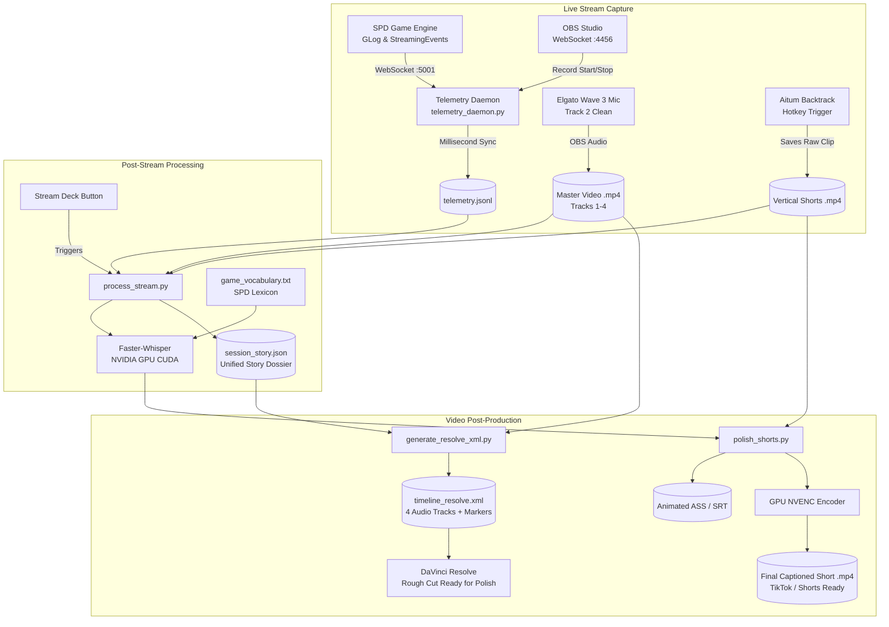

# Shattered Pixel Dungeon — Stream Telemetry & Automated Video Pipeline

A fully automated capture, transcription, and post-production pipeline for live streamers. It bridges in-game combat and dungeon events with OBS multi-track recording and AI speech-to-text, producing 1-click **DaVinci Resolve** timelines and polished **TikTok / YouTube Shorts** with animated captions.

---

## Architecture Overview



---

## Audio Track Mapping

OBS is configured to record **4 separate audio tracks** into a single master MP4 file:

| Track # | Name | Source / Device | Purpose |
| :--- | :--- | :--- | :--- |
| **Track 1** | **Master Mix** | Full Broadcast Mix | Complete reference mix including music and alerts. |
| **Track 2** | **Clean Voice** | Dalton's Mic (Wave:3) | Isolated speech for Whisper transcription and AI noise removal. |
| **Track 3** | **Alerts & Bot** | Streamer.bot / TTS / SFX | Channel point redemptions, chat spawns, sound alerts. |
| **Track 4** | **Game Audio** | Desktop / Java Process | SPD background music and sound effects. |

---

## Directory Organization

All stream recordings are automatically organized into structured session folders under `~/Videos/Stream_Sessions/`:

```
C:\Users\dalto\Videos\Stream_Sessions\
└── 2026-10-29_Stream_11-30-52/
    ├── 2026-10-29 11-30-52.mp4          # Master full-length recording (Tracks 1-4)
    ├── telemetry.jsonl                   # Synced in-game event log with video timestamps
    ├── session_story.json                # Master AI editing dossier (speech + events)
    ├── timeline_resolve.xml              # 1-click DaVinci Resolve import file
    └── shorts/
        ├── Backtrack 2026-10-29 11-45-10.mp4            # Raw vertical clip
        ├── Backtrack 2026-10-29 11-45-10.srt            # Standard SRT captions
        ├── Backtrack 2026-10-29 11-45-10.ass            # Styled karaoke highlight subtitles
        └── Backtrack 2026-10-29 11-45-10_captioned.mp4  # GPU-rendered final short ready to post
```

---

## Component Details

### 1. In-Game Telemetry (`GLog.java` & `StreamingBootstrapper.java`)
- **Location**: [`core/.../GLog.java`](file:///c:/Users/dalto/Documents/My%20Games/SPD/march26%20mod/shattered-pixel-dungeon-qol/core/src/main/java/com/shatteredpixel/shatteredpixeldungeon/utils/GLog.java) and [`desktop/.../StreamingBootstrapper.java`](file:///c:/Users/dalto/Documents/My%20Games/SPD/march26%20mod/shattered-pixel-dungeon-qol/desktop/src/main/java/com/shatteredpixel/shatteredpixeldungeon/desktop/StreamingBootstrapper.java)
- **Function**: Every game message (combat damage, items identified, hero low HP, player death, boss defeats, traps triggered, mob spawns) is queued onto a thread-safe `ConcurrentLinkedQueue` and broadcast over WebSocket `ws://127.0.0.1:5001`.

### 2. Telemetry Daemon (`telemetry_daemon.py`)
- **Location**: [`Lastest UI/telemetry_daemon.py`](file:///c:/Users/dalto/Documents/My%20Games/SPD/march26%20mod/shattered-pixel-dungeon-qol/Lastest%20UI/telemetry_daemon.py)
- **Function**: Runs silently as a background thread inside `server.py`. Listens to OBS WebSocket (`:4456`) and the game engine (`:5001`). When OBS starts recording, it records the exact system start time and writes incoming events to `telemetry.jsonl` with millisecond `video_time_sec` offsets.

### 3. Vocabulary Primer (`game_vocabulary.txt`)
- **Location**: [`scripts/game_vocabulary.txt`](file:///c:/Users/dalto/Documents/My%20Games/SPD/march26%20mod/shattered-pixel-dungeon-qol/scripts/game_vocabulary.txt)
- **Function**: Comprehensive dictionary of SPD items, potion colors (*"azure potion"*), scrolls, bosses (*"Goo"*, *Tengu*, *DM-300*, *King of Dwarves*, *Yog-Dzewa*), enemies, and streaming terms. Loaded as Whisper's `initial_prompt` to force 100% transcription accuracy on uncommon dungeon words.

### 4. Post-Stream Processor (`process_stream.py`)
- **Location**: [`scripts/process_stream.py`](file:///c:/Users/dalto/Documents/My%20Games/SPD/march26%20mod/shattered-pixel-dungeon-qol/scripts/process_stream.py)
- **Function**:
  1. Finds the latest stream video in `~/Videos`.
  2. Extracts Track 2 (clean mic) using `ffmpeg`.
  3. Preloads NVIDIA CUDA runtime DLLs and runs GPU Faster-Whisper transcription.
  4. Collects matching Aitum Backtrack clips created during the stream window.
  5. Assembles `session_story.json` aligning spoken lines and dungeon events chronologically.
  6. Organizes all assets into `~/Videos/Stream_Sessions/<session_slug>/`.
  7. Invokes `generate_resolve_xml.py` to auto-produce `timeline_resolve.xml`.
  8. Invokes `polish_shorts.py` to auto-caption vertical clips.

### 5. DaVinci Resolve Exporter (`generate_resolve_xml.py`)
- **Location**: [`scripts/generate_resolve_xml.py`](file:///c:/Users/dalto/Documents/My%20Games/SPD/march26%20mod/shattered-pixel-dungeon-qol/scripts/generate_resolve_xml.py)
- **Function**: Generates Apple Final Cut Pro XML (`xmeml` version 4) compatible with DaVinci Resolve:
  - Preserves all 4 discrete audio tracks using `<sourcetrack>` indexing.
  - Generates timeline rough cuts around intro, boss battles, low-HP clutches, and vertical clips.
  - Adds color-coded sequence markers (Green for Bosses, Red for Death/Near-Death, Cyan for Backtrack clips).
  - Can be driven by automated heuristic cuts or custom AI Edit Decision Lists (`cuts.json`).

### 6. Shorts Polishing Engine (`polish_shorts.py`)
- **Location**: [`scripts/polish_shorts.py`](file:///c:/Users/dalto/Documents/My%20Games/SPD/march26%20mod/shattered-pixel-dungeon-qol/scripts/polish_shorts.py)
- **Function**:
  - Runs word-timestamped transcription on vertical MP4 clips.
  - Chunks dialogue into 3–4 word bite-sized phrases.
  - Generates `.ass` subtitles with dynamic yellow karaoke pop (`{\c&H0024E5FF&}`) on the active spoken word, styled in bold Impact with heavy black outline and positioned safely above mobile UI overlays.
  - Uses NVIDIA NVENC hardware encoder to burn subtitles into `<clip>_captioned.mp4` at near-instant rendering speeds.

---

## Daily Operational Guide

### 1. Starting a Stream
1. Launch the UI server:
   ```powershell
   python "Lastest UI/server.py"
   ```
2. Launch the game jar:
   ```powershell
   java -jar desktop/build/libs/desktop-4.0.2-QoL-8.jar
   ```
3. In OBS, start recording. (The telemetry daemon auto-detects the recording event).

### 2. Ending a Stream
1. In OBS, stop recording.
2. Press your **Process Stream** Stream Deck button (or run `python scripts/process_stream.py`).
3. Leave the terminal open while it processes. It will finish with:
   ```
   =================================================================
      PROCESSING COMPLETE! SESSION PACKAGED & READY
   =================================================================
   ```

### 3. Editing in DaVinci Resolve
1. Open DaVinci Resolve and create or open your project.
2. Press <kbd>Ctrl</kbd> + <kbd>Shift</kbd> + <kbd>I</kbd> (**File -> Import -> Timeline...**).
3. Select `timeline_resolve.xml` from the session folder:
   `C:\Users\dalto\Videos\Stream_Sessions\<session_name>\timeline_resolve.xml`
4. Make your trims, balance track audio, and add transitions.

### 4. Custom AI Cut Workflow
If you want an AI editing agent to craft a tailored narrative cut:
1. Pass `session_story.json` and [`scripts/editor_agent_prompt.md`](file:///c:/Users/dalto/Documents/My%20Games/SPD/march26%20mod/shattered-pixel-dungeon-qol/scripts/editor_agent_prompt.md) to your AI agent.
2. Save the agent's output as `cuts.json` inside the session folder.
3. Run:
   ```powershell
   python scripts/generate_resolve_xml.py "C:\Users\dalto\Videos\Stream_Sessions\<session_name>" cuts.json
   ```
4. Re-import the newly updated `timeline_resolve.xml` in DaVinci Resolve.

---

## Troubleshooting & Maintenance

### Port Conflicts (WebSocket :5001)
- If telemetry events are not being received from the game, check for dangling `javaw.exe` instances holding port `5001`:
  ```powershell
  Get-Process -Name javaw | Stop-Process -Force
  ```
- Always start the UI server before or alongside the game.

### OBS WebSocket Connection (:4456)
- OBS WebSocket server must be enabled on port `4456` with authentication disabled (or matching credentials).
- In OBS: **Tools -> WebSocket Server Settings -> Server Port: 4456**, **Enable WebSocket server: Checked**.

### Faster-Whisper GPU CUDA Acceleration
- If `cublas64_12.dll` or `cudnn64_9.dll` errors appear, ensure the NVIDIA runtime wheels are installed:
  ```powershell
  pip install nvidia-cublas-cu12 nvidia-cudnn-cu12
  ```
- Both `process_stream.py` and `polish_shorts.py` include automatic DLL discovery and preloading via `setup_cuda_dlls()`, with seamless fallback to CPU (`int8`) if a GPU runtime error occurs.

### Adding New Vocabulary
- To teach Whisper new terms, simply add them as new lines in [`scripts/game_vocabulary.txt`](file:///c:/Users/dalto/Documents/My%20Games/SPD/march26%20mod/shattered-pixel-dungeon-qol/scripts/game_vocabulary.txt). Lines starting with `#` are treated as comments.
