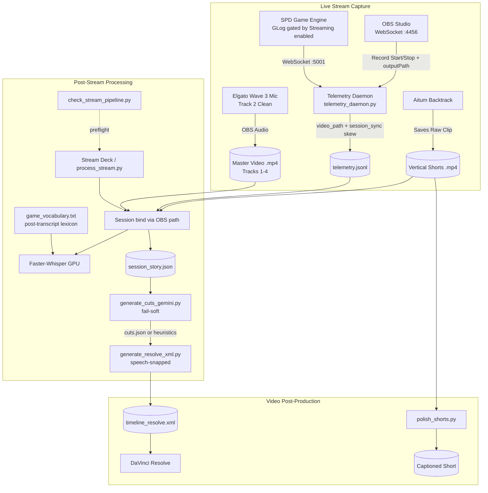

# Shattered Pixel Dungeon — Stream Telemetry & Automated Video Pipeline

Capture, transcription, and post-production pipeline for live streams. The game engine and OBS sync events into `telemetry.jsonl`; post-stream processing builds a story dossier, optional Gemini Edit Decision List, speech-snapped DaVinci Resolve XML, and captioned vertical Shorts.

**Keep raw `game_log` events** — they stay in telemetry and `session_story.json` unfiltered.

---

## Architecture Overview



---

## Audio Track Mapping

| Track # | Name | Source / Device | Purpose |
| :--- | :--- | :--- | :--- |
| **Track 1** | **Master Mix** | Full Broadcast Mix | Complete reference mix including music and alerts. |
| **Track 2** | **Clean Voice** | Dalton's Mic (Wave:3) | Isolated speech for Whisper transcription. |
| **Track 3** | **Alerts & Bot** | Streamer.bot / TTS / SFX | Channel point redemptions, chat spawns, sound alerts. |
| **Track 4** | **Game Audio** | Desktop / Java Process | SPD music and SFX. |

---

## Directory Organization

```
C:\Users\dalto\Videos\Stream_Sessions\
└── 2026-10-29_Stream_11-30-52/
    ├── 2026-10-29 11-30-52.mp4
    ├── telemetry.jsonl
    ├── session_story.json
    ├── cuts.json                 # optional Gemini EDL
    ├── timeline_resolve.xml
    ├── captions.srt              # EDIT timeline clock — import on timeline_resolve.xml
    ├── captions_full.srt         # Full master VOD clock (optional reference)
    └── shorts/
        └── Backtrack *.mp4 + matching .srt
```

---

## Component Details

### 1. In-Game Telemetry (`GLog.java` & `StreamingBootstrapper.java`)
- Game log lines are broadcast only when **Streaming enabled** is on in SPD settings (`SPDSettings.streamingEnabled()`).
- Death / boss events remain on their existing WebSocket paths.
- Raw `game_log` messages are queued and sent over `ws://127.0.0.1:5001`.

### 2. Telemetry Daemon (`telemetry_daemon.py`)
- Background thread inside `server.py`.
- On OBS record start: stores wall-clock start + OBS `outputPath`.
- When the MP4 appears: writes `session_sync` with `file_*_ms` and `clock_skew_ms`.
- Events include millisecond `video_time_sec` offsets.

### 3. Vocabulary (`game_vocabulary.txt` + `game_vocab_utils.py`)
- Whisper uses a **short** initial prompt: `"Shattered Pixel Dungeon live commentary."`
- After transcription, terms from `game_vocabulary.txt` are applied as lexicon corrections (not dumped into the Whisper prompt).

### 4. Post-Stream Processor (`process_stream.py`)
Session resolution order:
1. CLI: `python scripts/process_stream.py [session_folder | video.mp4 | telemetry.jsonl]`
2. Newest telemetry whose `session_start.video_path` exists on disk
3. Fallback: newest non-Backtrack mp4 in `~/Videos` (**loud warning**)

Then: Track 2 extract → GPU Whisper → apply clock skew → package session → **Gemini `cuts.json` (fail-soft)** → speech-snapped Resolve XML → `captions.srt` → Shorts `.srt` sidecars (no burn-in).

### 5. Gemini EDL (`generate_cuts_gemini.py`)
- Reads `GEMINI_API_KEY` from the environment (or gitignored `secrets.local.json`).
- Uses `editor_agent_prompt.md` + compact `session_story` payload.
- On missing key / API error: process continues with heuristic cuts.

### 6. DaVinci Resolve Exporter (`generate_resolve_xml.py`)
- 4 discrete audio tracks preserved.
- Heuristic or Gemini cuts are **snapped to speech** (≈0.6s pre-roll / ≈1.0s post-roll).
- Markers for bosses, death / near-death, Backtrack highlights.

### 7. Captions / Shorts (`process_stream.py` + `polish_shorts.py`)
- `captions.srt` — speech remapped onto the **edited** Resolve timeline (same cuts as `timeline_resolve.xml`). Import this as the Subtitle track.
- `captions_full.srt` — same transcript on the **full master VOD** clock (reference only).
- Shorts: `.srt` sidecars only by default. Optional `python scripts/polish_shorts.py --burn` for ASS + `*_captioned.mp4`.

### 8. Shared CUDA helper (`whisper_cuda.py`)
- Used by `process_stream.py`, `polish_shorts.py`, and `check_stream_pipeline.py`.

---

## Daily Operational Guide

### Preflight (optional, recommended)
```powershell
python scripts/check_stream_pipeline.py
```
Checks OBS WS, game WS, ffmpeg, Videos/telemetry writability, Gemini key, CUDA DLLs.

### Starting a Stream
1. Enable **Streaming** in SPD settings (required for live `game_log` telemetry).
2. Launch UI server: `python "Lastest UI/server.py"`
3. Launch game jar.
4. Start recording in OBS (daemon binds to that file’s `outputPath`).

### Ending a Stream
1. Stop recording in OBS.
2. Run Process Stream:
   ```powershell
   python scripts/process_stream.py
   ```
   Or pass an explicit session/video/telemetry path.
3. Wait for `PROCESSING COMPLETE`.

### Editing in DaVinci Resolve
1. **File → Import → Timeline...** (`Ctrl+Shift+I`)
2. Open `timeline_resolve.xml` from the session folder.

### Manual AI override
Still supported: edit/replace `cuts.json`, then:
```powershell
python scripts/generate_resolve_xml.py "C:\Users\dalto\Videos\Stream_Sessions\<session_name>"
```

---

## Troubleshooting

### Port Conflicts (:5001)
```powershell
Get-Process -Name javaw | Stop-Process -Force
```

### OBS WebSocket (:4456)
Enable WebSocket server in OBS Tools settings.

### Faster-Whisper CUDA
```powershell
pip install nvidia-cublas-cu12 nvidia-cudnn-cu12
```

### Gemini
```powershell
# User env (restart terminals / Stream Deck after setting)
[System.Environment]::SetEnvironmentVariable("GEMINI_API_KEY", "YOUR_KEY", "User")
```
Or create gitignored `Lastest UI/secrets.local.json`:
```json
{ "GEMINI_API_KEY": "YOUR_KEY" }
```

### Adding vocabulary
Add lines to `scripts/game_vocabulary.txt` (comments with `#`). Used for post-transcript correction.
